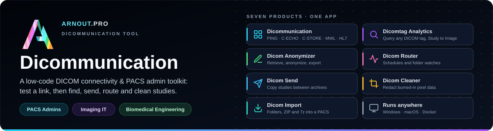
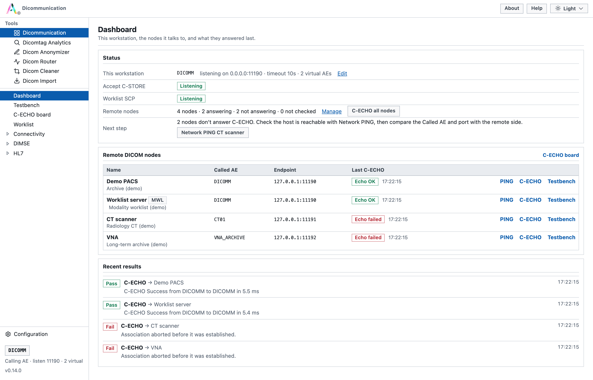
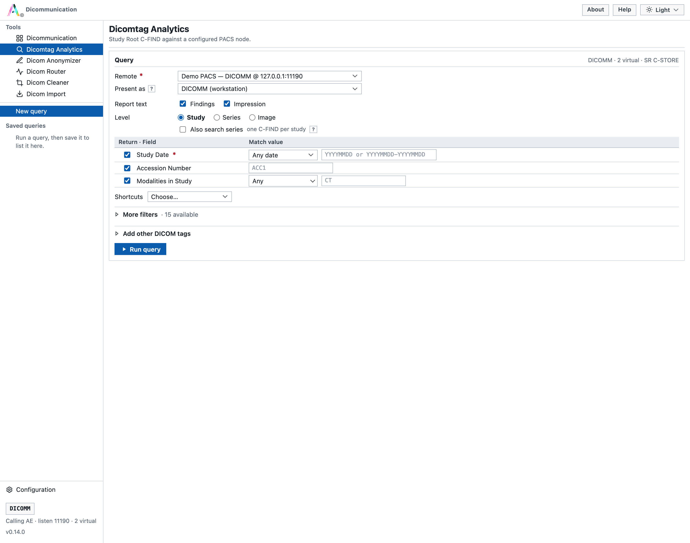
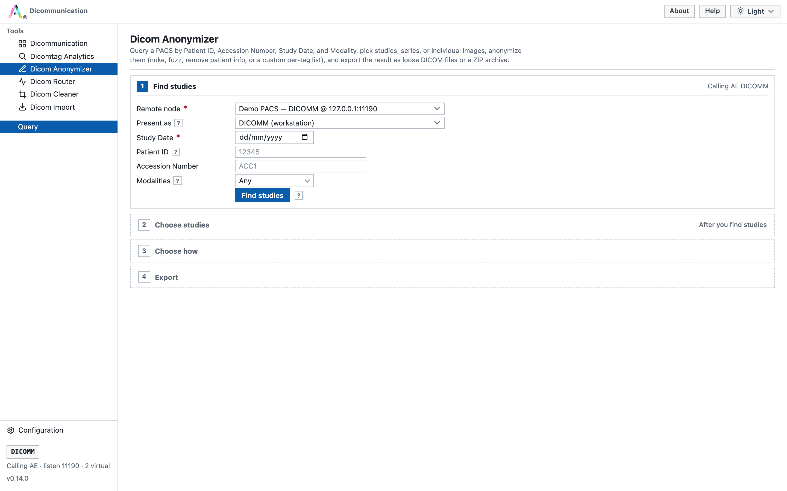
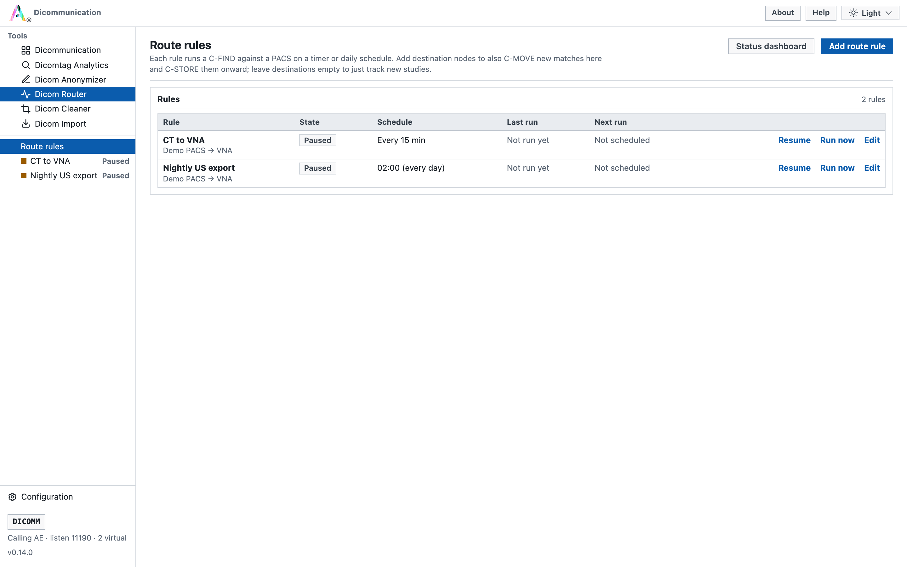
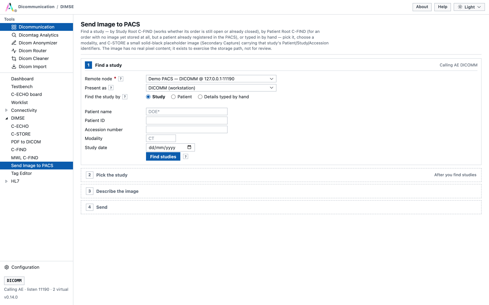
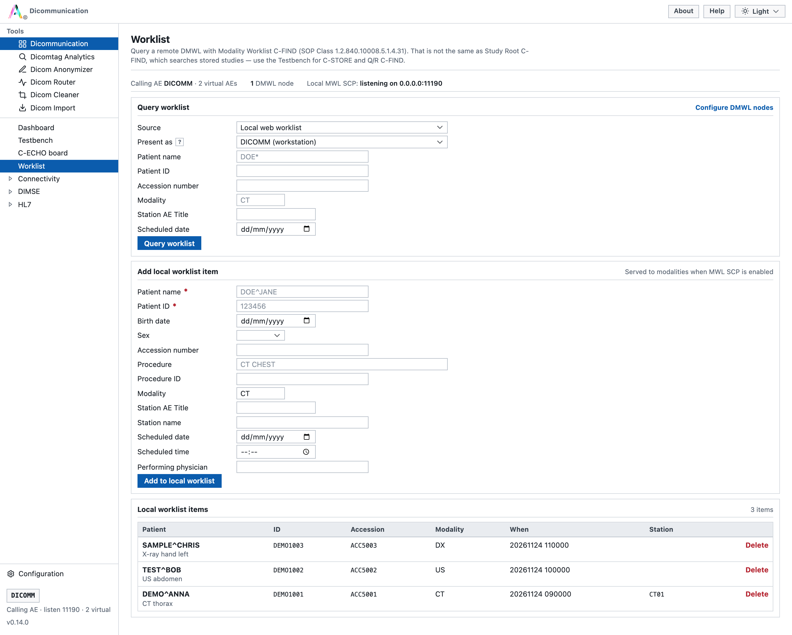

# Arnout.pro Dicommunication Tool

A low-code DICOM communication validator and PACS admin toolkit.

**Published as-is. All rights reserved.** The source is public so you can read it and download builds. This is not an invitation to use it as a library, fork it, or send patches. Issues and pull requests are not accepted. See [CONTRIBUTING.md](CONTRIBUTING.md).

Dicommunication is a web application for PACS administrators, imaging IT and biomedical engineering. Configure this computer as a DICOM Application Entity, register remote nodes (PACS, Orthanc, RIS/MWL, modalities), impersonate extra calling AE Titles, and run the checks a connectivity ticket actually needs: network PING, C-ECHO, simulated C-STORE, PDF to Encapsulated PDF Storage, Study Root C-FIND (Study, Series and Image level), Modality Worklist C-FIND, and HL7 v2 send over MLLP. On top of that it works on studies: query, retrieve and **anonymize** them, **redact** burned-in pixel data, **route** new studies on a schedule, and **import** a folder of DICOM files into a PACS.

It is **one application with six products**, picked with the tool switcher at the top of the left sidebar. Each product has its own pages in the sidebar below it:

| Product | What it is for |
| --- | --- |
| **Dicommunication** | The network, DIMSE and HL7 workstation tools: Dashboard, Testbench, C-ECHO board, Worklist, Network PING, C-ECHO, C-STORE, PDF to DICOM, C-FIND, MWL C-FIND, Send Image to PACS, Tag Editor and HL7 send |
| **Dicomtag Analytics** | Study Root C-FIND at Study, Series or Image level with any DICOM tag (including Vue ELSCINT1 keys), saved queries, and listing and retrieving DICOM Structured Reports |
| **Dicom Anonymizer** | Query a PACS, pick studies and series, retrieve them, anonymize them (four modes) and export them to a folder or a ZIP |
| **Dicom Router** | Scheduled C-FIND rules with optional retrieve-and-forward, rules that watch a folder and send new PDFs to a PACS, and a status dashboard with a chart per rule |
| **Dicom Cleaner** | Query, retrieve, black out a rectangle of burned-in pixel data and send the result back over C-STORE |
| **Dicom Import** | Scan a folder or ZIP file (DICOMDIR and/or loose DICOM files, also inside .zip files), change patient and exam details, and send the images to a PACS |

**Configuration** (Local AE, virtual AE titles, remote nodes, import / export of settings, users, security, audit log and logs) sits at the bottom of the left sidebar and is shared by every product. It is for administrators. **About** (the running version) and **Help** (the in-app guide) are in the top bar, next to the theme switcher (light, dark, follows the device, professional dark).

Three ways to run it:

- **Windows**: an MSI that installs a background service you open in the browser ([Windows MSI](#windows-msi)).
- **macOS** (Apple Silicon): a DMG with a package that installs a background service the same way ([macOS DMG](#macos-dmg)).
- **Docker Compose**: everywhere else, and for development ([Run it](#run-it)).

Sign-in with roles, HTTPS and an audit log are built in and turn on when the app can be reached from another computer, or always in the two installers ([Security](#security)).

The web UI is FastAPI + HTMX. DICOM uses pynetdicom/pydicom. New test tools are Python plugins: drop a file in `app/tools/` and it appears in the Dicommunication sidebar. The look is deliberately flat and dense (square corners, thin lines, small type, tooltips instead of long help text); see [DESIGN.md](DESIGN.md).

Open [http://127.0.0.1:8080](http://127.0.0.1:8080).

## Screenshots

The screenshots follow your GitHub theme (light or dark). They come from a demo setup with made-up nodes and patient names, not clinical data. All pages, in both themes, are in [docs/screenshots/0.14](docs/screenshots/0.14).

**Dashboard: this workstation, its remote nodes and their last C-ECHO**

<picture>
  <source media="(prefers-color-scheme: dark)" srcset="docs/screenshots/0.14/dark/dashboard.png">
  
</picture>

**Dicomtag Analytics: query a PACS on any DICOM tag**

<picture>
  <source media="(prefers-color-scheme: dark)" srcset="docs/screenshots/0.14/dark/c-find-advanced.png">
  
</picture>

**Dicom Anonymizer**

<picture>
  <source media="(prefers-color-scheme: dark)" srcset="docs/screenshots/0.14/dark/anonymize.png">
  
</picture>

**Dicom Router: route rules**

<picture>
  <source media="(prefers-color-scheme: dark)" srcset="docs/screenshots/0.14/dark/router.png">
  
</picture>

**Send Image to PACS**

<picture>
  <source media="(prefers-color-scheme: dark)" srcset="docs/screenshots/0.14/dark/send-image.png">
  
</picture>

**Worklist: query a DMWL or serve a local worklist**

<picture>
  <source media="(prefers-color-scheme: dark)" srcset="docs/screenshots/0.14/dark/worklist.png">
  
</picture>

## What's new in 0.15

The full list is in [CHANGELOG.md](CHANGELOG.md).

- **Stop listening / Start listening.** A button on the Dashboard and on the Local DICOM AE page frees this workstation's DICOM port at once, so another program (a viewer such as MicroDicom) can use it, and takes it back when you start listening again. It only pauses the listener: your MWL SCP and C-STORE settings stay, and a pause survives a restart.
- **macOS: the service no longer ends up stopped after a port change or an upgrade** (it waits for launchd to let go of the old job before starting the new one).

## What's new in 0.14

The full list is in [CHANGELOG.md](CHANGELOG.md).

- **Dicom Router: watch a folder for PDFs (0.14.1).** A route rule has a *Kind*: query a PACS, or watch a folder and send each new PDF as a DICOM document, moving it to `Sent` or `Failed`. An optional file name pattern such as `{PatientID}_{PatientName}_{Accession}` reads the patient and study from the file name.
- **A new, flatter look.** Square corners and thin lines everywhere, 13 px type in the system font, plain blue on neutral greys, no icon tiles or striped rows. The sidebar is a tree with a solid colour on the selected row. Configuration moved from the top bar to the bottom of the left menu. The area where data is shown is one flat surface in every theme (white in the light theme).
- **Forms with the label on the left and the box beside it**, as wide as its content, with the explanation in a `?` tooltip instead of grey paragraphs, and advanced options folded away. Every tool and configuration page uses it. Dicomtag Analytics is now one flat table (Return, Field, Match value) with a Study Date period menu, a Modalities dropdown and a shortcuts menu instead of rows of buttons.
- **Dicom Anonymizer: see and pick the series.** Under each study, "Show series" lists its series (number, modality, description, images); only the ticked ones are anonymized. New export options: *All files in one folder* or *a subfolder per series*, and study and series folders named by their **description** (off by default, because a description can contain identifying text).
- **Nothing is lost silently when a PACS drops the connection.** Some PACS close the association after a few C-MOVEs. The Anonymizer and the Cleaner now reconnect, list every series with how many images came back, and report a run with anything missing as a **Fail** that names what is missing.
- **Status dashboard (`/lite`) with history charts.** One bar chart per rule (and per status value) of exams per day for the last 7, 14 or 30 days, from counts the Router now keeps per study date. A dashed mark means no check that day. No patient data is stored.
- **Searching with wildcards in the Vue style.** `%123%` finds every Patient ID that contains 123; it is sent to the PACS as the DICOM wildcard `*123*`. `*` and `?` work as before.
- **Folder buttons say why they do nothing.** In the service editions there is no desktop, so the folder dialog cannot open there: the button is greyed and a line says to type the path.
- Dropdown lists are compact, scroll when long and open upwards when there is no room below. The README and Help no longer say the app has no login.

Earlier highlights, each with its details in the changelog:

- **0.13**: the macOS download became a background service like the Windows one; PDF to DICOM can set the Modality of the document.
- **0.12 and 0.11**: one Windows installer (the Windows service); sign-in with viewer / operator / administrator roles, HTTPS with a certificate the app makes itself, a tamper-evident audit log, and much less patient data kept (the Router history holds counts only).
- **0.10**: Dicom Import; import / export of settings; the status dashboard; any DICOM tag in Dicomtag Analytics; the Windows service edition.
- **Before 0.10**: Dicom Router, Dicom Cleaner, Dicom Anonymizer, Send Image to PACS, Tag Editor, saved Analytics queries, and the 0.5.1 security review ([SECURITY.md](SECURITY.md#security-review-051-september-2026)).

## Contents

- [Screenshots](#screenshots)
- [What's new in 0.14](#whats-new-in-014)
- [What this is (and is not)](#what-this-is-and-is-not)
- [How it's made](#how-its-made)
- [DICOM services this tool distinguishes](#dicom-services-this-tool-distinguishes)
- [Run it](#run-it)
- [Windows MSI](#windows-msi)
- [macOS DMG](#macos-dmg)
- [Where data is stored](#where-data-is-stored)
- [Configuration](#configuration)
- [Logs](#logs)
- [Virtual local AE titles](#virtual-local-ae-titles)
- [Test tools](#test-tools)
- [Worklist](#worklist)
- [HL7 send](#hl7-send)
- [Talking to Orthanc on a LAN](#talking-to-orthanc-on-a-lan)
- [JSON API](#json-api)
- [Add a tool plugin](#add-a-tool-plugin)
- [Tests](#tests)
- [Security](#security)
- [Troubleshooting](#troubleshooting)

## What this is (and is not)

This is a **trusted-network admin workstation**. Use it on the PACS VLAN, a lab, or a jumphost that can reach DICOM ports. It is not a PACS, not a viewer, and not a replacement for vendor modality simulators.

It **does**:

- Present a calling AE Title (the workstation, or a virtual identity such as `CT1`)
- Associate with a remote AE and show which SOP Classes were accepted or rejected
- Send Verification (C-ECHO), a tiny Secondary Capture (C-STORE), Encapsulated PDF Storage (PDF to DICOM), Study Root Query/Retrieve C-FIND at Study, Series, or Image level, and Modality Worklist C-FIND
- Optionally serve a local web worklist as an MWL SCP on the listen port
- Optionally accept C-STORE on that same port, so it can receive what a PACS moves to it: Structured Reports for Dicomtag Analytics (the Content Sequence is parsed, no language model), and the images that the Anonymizer, Cleaner and Router retrieve
- Retrieve studies, series and images with C-MOVE to this workstation, then anonymize them and write files to a folder or ZIP (Dicom Anonymizer), black out a rectangle and send them back (Dicom Cleaner), or forward them to other nodes on a schedule (Dicom Router)
- Scan a folder of DICOM files and send them to a PACS, with optional edits applied on the way (Dicom Import)
- Send an HL7 v2 message over TCP (MLLP by default) to a host:port
- Ask for a sign-in, with roles, over HTTPS, and keep an audit log, when it can be reached from other computers ([Security](#security))

It **does not**:

- Use C-GET. Every retrieve is a C-MOVE to this workstation's own Storage SCP, which must be enabled and registered on the PACS as a destination
- Keep an archive of clinical images. Retrieved images are held in memory while a run is going; what the Anonymizer exports is written where you tell it, and Dicom Import only reads
- Speak DICOM TLS (DICOM and HL7 traffic to the PACS is not encrypted)
- Encrypt its own data folder (use an encrypted volume; see [Security](#security))
- Parse, validate, or map HL7 fields — paste a message and send it

A successful C-ECHO only proves Verification. Orthanc (or any PACS) can accept C-ECHO and still reject Storage, Query/Retrieve, or Modality Worklist. That difference is the point of the Testbench.

## How it's made

Dicommunication is made by one person: me, Arnout van der Elst. I'm not a software team; I bring the clinical, workflow and IT knowledge of working with PACS, RIS, modalities and HL7 interfaces in a hospital. The code is written with the help of AI, mainly **Claude** (Anthropic) and **Cursor**.

In practice the split looks like this:

- **I decide what gets built and why.** The problems come from real connectivity tickets and reading-room workflows: a node that answers C-ECHO but rejects Storage, a report stuck in Vue, a study that needs anonymizing before it leaves the hospital. I set the requirements, the order of the steps on each page, and what counts as safe.
- **The AI writes most of the code, tests and documentation** under that direction: the FastAPI and HTMX pages, the pynetdicom and pydicom work, the design, this README and the in-app Help.
- **I review and test it**, and so does the test suite: about 800 automated tests, including ones that talk to small DICOM and HL7 servers running on the same machine. Where it matters, behaviour is checked against the standards themselves, such as the HL7 v2 code tables and the DICOM data dictionary, and against vendor documentation.
- **Anything not yet proven on a real system says so.** For example, the HL7 send options for Philips IS Link are still on a [To verify](#to-verify) list until they have been tested on a live server.

AI makes it possible for one person with domain knowledge to build a tool like this. It doesn't replace that knowledge, or the testing against real equipment before anything touches clinical data.

## DICOM services this tool distinguishes

| UI name | DIMSE | SOP Class | What it actually tests |
| --- | --- | --- | --- |
| C-ECHO | C-ECHO | Verification `1.2.840.10008.1.1` | Association plus a DICOM ping. Connectivity only. |
| C-STORE | C-STORE | Secondary Capture Image Storage | Can the peer *receive* an instance? |
| PDF to DICOM | C-STORE | Encapsulated PDF Storage `1.2.840.10008.5.1.4.1.1.104.1` | Wrap a PDF as a DICOM document and store it. A peer that takes Secondary Capture may still reject Encapsulated PDF. |
| C-FIND | C-FIND | Study Root Query/Retrieve FIND | Search *stored studies* in a PACS archive at STUDY level. Zero matches can still be a successful Q/R C-FIND. |
| Dicomtag Analytics | C-FIND, optional C-MOVE | Study Root Query/Retrieve FIND (and MOVE for SR) | Reached at `/tools/c-find-advanced` in the sidebar. Same SOP Class at Study, Series, or Image plus optional Vue ELSCINT1 keys. Hierarchical: Series needs Study Instance UID; Image needs Study and Series Instance UID. **List SR reports** is Series C-FIND with modality `SR` for every study in the table. **Retrieve report text** C-MOVEs each listed SR on its own association and parses the Content Sequence. Results copy / CSV / JSON. |
| MWL C-FIND / Worklist | C-FIND | Modality Worklist `1.2.840.10008.5.1.4.31` | Search *scheduled procedures*, not the archive. |
| Send Image to PACS | C-FIND (Study or Patient Root, or none for manual entry), C-STORE | Study Root Query/Retrieve FIND, Patient Root Query/Retrieve FIND, then Secondary Capture Image Storage | Reached at `/tools/send-image` in the sidebar. Find a study — by Study Root C-FIND (open or already closed), by Patient Root C-FIND (for an order with no image yet stored at all, but a registered patient), or typed in by hand — pick it, choose a modality and a few descriptive tags, and C-STORE a small solid-black placeholder image carrying that study's Patient/Study/Accession identifiers. |
| Dicom Router | C-FIND, optional C-MOVE + C-STORE | Study Root Query/Retrieve FIND (MOVE/STORE for retrieve-and-forward) | Reached at `/router` in the sidebar. Same FIND as Dicomtag Analytics, but scheduled/automatic instead of manual, with an optional automatic retrieve-and-forward to one or more destination nodes. |
| Dicom Cleaner | C-FIND, C-MOVE, C-STORE | Study Root Query/Retrieve FIND/MOVE, then Storage back out | Reached at `/tools/dicom-cleaner` in the sidebar. Study-level C-FIND, C-MOVE retrieve, blacks out one operator-configured rectangle of pixel data on every retrieved instance (PyDicom + numpy), then C-STOREs the cleaned instances back to a PACS. |
| Dicom Anonymizer | C-FIND, C-MOVE | Study Root Query/Retrieve FIND and MOVE | Reached at `/tools/anonymize` in the sidebar. A Study-level C-FIND, an optional Series-level C-FIND to list a study's series, then a C-MOVE of the chosen studies or series to this workstation's local Storage SCP. The instances are anonymized in memory and written to a folder or ZIP; nothing is sent back. |
| Dicom Import | C-STORE | Storage (each file's own SOP Class) | Reached at `/tools/dicom-import` in the sidebar. Scans a folder and C-STOREs its files to a PACS, with optional edits; there is no query. |
| Tag Editor | C-FIND, C-MOVE, C-STORE | Study Root Query/Retrieve FIND and MOVE, then storage back | Reached at `/tools/tag-editor` in the sidebar. Corrects two private Vue report tags on a study and stores it back. |

**MWL C-FIND and the Worklist page are the same SOP Class.** Study Root C-FIND is not. Orthanc without the worklist plugin typically accepts Verification, Storage, and Q/R, then rejects MWL. The Testbench and Worklist results show accepted vs rejected presentation contexts so that is visible.

Two AE Titles matter on a worklist query:

- **Calling AE Title** — who you are on the association. The remote must allow this AE (Orthanc `DicomModalities`, vendor “known AEs”, etc.).
- **Scheduled Station AE Title** — a query key in the MWL identifier. Modalities normally ask for procedures scheduled to their own station (`CT1`, `MR1`, …).

## Run it

### Docker Compose (recommended)

The image already contains Python, FastAPI, pynetdicom, pydicom, and `ping`. You do not need a local virtualenv.

```bash
git clone https://github.com/arnoutpro/dicommunication.git
cd dicommunication
docker compose up --build
```

Open [http://127.0.0.1:8080](http://127.0.0.1:8080). Stop with Ctrl+C, or run detached:

```bash
docker compose up --build -d
```

Compose publishes:

| Port | What | Published on | Override |
| --- | --- | --- | --- |
| `8080` | Web UI and JSON API | `127.0.0.1` — this machine only | `DICOMM_HTTP_BIND` |
| `11112` | Optional local MWL SCP (only listens if you enable it in Configuration) | every interface, so a modality can C-FIND this workstation | `DICOMM_DICOM_BIND` |

With no account yet the UI has no login, so it is kept on loopback. To reach it from another machine, publish it deliberately. That turns on sign-in (the first administrator is created from the container, see [SECURITY.md](SECURITY.md)) and HTTPS:

```bash
DICOMM_HTTP_BIND=0.0.0.0 docker compose up -d
```

If the proxy serves the UI under a host name (`https://dicomm.example.org`), add that name to `DICOMM_ALLOWED_HOSTS` (comma-separated). The app only answers to `localhost` and IP addresses by default, so a web page on another site cannot reach it through a DNS trick; see [SECURITY.md](SECURITY.md#protection-against-other-websites):

```bash
DICOMM_HTTP_BIND=0.0.0.0 DICOMM_ALLOWED_HOSTS=dicomm.example.org docker compose up -d
```

`DICOMM_DICOM_BIND` pins the MWL SCP to one address (for example `DICOMM_DICOM_BIND=10.0.0.5`) when the host has several NICs and only one faces the modality VLAN.

Startup names the address the UI was published on, so `docker compose logs` answers "why can I not reach this from my laptop":

```
Dicommunication 0.15.0 started (data dir /app/data, log level INFO)
Web UI published on 127.0.0.1:8080 — reachable from the Docker host only. This is the
default. To reach it from another machine, restart with DICOMM_HTTP_BIND=0.0.0.0
(that turns on sign-in and HTTPS).
```

It also sets `host.docker.internal` so a PACS on the Docker host (typical on a Mac) is reachable from inside the container.

### Published image (GHCR)

Pushes to `main` build `ghcr.io/arnoutpro/dicommunication:latest`. After that image exists:

```bash
docker compose pull
docker compose up -d
```

or without Compose:

```bash
mkdir -p ~/.dicommunication
docker run --rm \
  -p 127.0.0.1:8080:8080 -p 11112:11112 \
  -v "$HOME/.dicommunication:/app/data" \
  -e DICOMM_DATA_DIR=/app/data \
  ghcr.io/arnoutpro/dicommunication:latest
```

`-p 127.0.0.1:8080:8080` keeps the UI on this machine, where it opens without a login until you create the first user. Drop the `127.0.0.1:` only when you want it reachable from the network; set `DICOMM_HTTP_BIND=0.0.0.0` as well so sign-in and HTTPS are on, and put it behind your own proxy or firewall if it is exposed beyond a trusted network.

### Update

```bash
git pull origin main
docker compose up --build -d
```

Rebuilding the image does not wipe AE titles if config lives in `~/.dicommunication` (see below).

### Local Python (optional)

```bash
python3 -m venv .venv
source .venv/bin/activate
pip install -r requirements-dev.txt
make run
```

That serves the UI on port 8080 with reload. Use this when developing plugins; Docker is the supported way to run it on a PACS admin laptop.

## Windows MSI

The browser does **not** need Python. Opening [http://127.0.0.1:8080](http://127.0.0.1:8080) is a normal web page.

Python **is** required to *serve* that page and to speak DICOM (FastAPI, pynetdicom, ping, disk config). You should not install Python yourself on a locked-down PACS PC. The MSI freezes a private runtime into `Program Files\Dicommunication`. Docker does the same thing inside the image. A local venv is only for developers.

**Those components cannot be installed from this app's webpage.** The UI is served *by* the Python process, so the page only exists after the backend is already running. A "download Python from this screen" button would be a chicken-and-egg, and a web bootstrapper that fetches python.org at install time is a poor fit for hospital VLANs (often offline, SmartScreen/AV, no admin). The MSI is the offline installer IT can push with Intune or GPO.

There is **one Windows installer**, which installs the Windows service: CI builds `dicommunication-<version>-win64.msi` on `windows-latest` (workflow **Windows MSI**). It installs the program as a Windows service named Dicommunication that starts with Windows, has no window, and is opened in the browser at `http://localhost:<port>/` (`https://` when you tick the network option). Sign-in is always on. The desktop-window installer was dropped after 0.11.2; installing the current MSI over it replaces it, but its settings are not carried over, so export them first (Configuration > Import / export). See [`packaging/windows/README.md`](packaging/windows/README.md) for the wizard, the first administrator, the data folder (`C:\ProgramData\Dicommunication`) and unattended installs.

A `v*` tag attaches the MSI to the GitHub Release and also publishes **`dicommunication.msi`** on [GitHub Packages](https://github.com/arnoutpro/dicommunication/pkgs/nuget/dicommunication.msi) (NuGet). GitHub has no MSI registry; the nupkg carries `tools/dicommunication-<version>-win64.msi`. GitHub Packages always needs a token, even for a public package, so anonymous hospital downloads should keep using the [GitHub Release](https://github.com/arnoutpro/dicommunication/releases).

```text
dotnet nuget add source --name github-arnoutpro --username YOUR_GITHUB_USERNAME --password YOUR_PAT --store-password-in-clear-text https://nuget.pkg.github.com/arnoutpro/index.json
dotnet nuget install dicommunication.msi --version <version> --source github-arnoutpro
```

Uninstalling asks, once, whether to also delete the data folder, because it can hold patient data (see [`SECURITY.md`](SECURITY.md#patient-data-on-disk)); answering No (the default) leaves it in place.

Unsigned builds trigger SmartScreen until a code-signing certificate is used. If a modality must C-FIND this workstation, allow inbound TCP for `dicommunication.exe` (listen port 11112). A local build script is in [`packaging/windows/build.ps1`](packaging/windows/build.ps1).

## macOS DMG

Same idea as the MSI: the browser does **not** need Python. The installer freezes a private runtime, so you should not install Python yourself on a locked-down PACS Mac. Docker does the same thing inside the image.

**Those components cannot be installed from this app's webpage.** The UI is served *by* the Python process, so the page only exists after the backend is already running. Ship the DMG through IT (or a USB stick), not through a button on localhost.

Like the Windows installer, the macOS one installs a **background service**: `dicommunication-<version>-macos-arm64.dmg` holds `Dicommunication.pkg`, which installs the program in `/usr/local/lib/dicommunication` and a launchd service (`pro.arnout.dicommunication`) that starts with the Mac, needs nobody logged in, has no window, and runs as its own hidden account `_dicommunication`. Sign-in is always on. Its data (settings, history, logs, which can hold patient data) lives in `/Library/Application Support/Dicommunication`, readable only by that account.

1. Open the DMG and run `Dicommunication.pkg` (it asks for an administrator password). The build is unsigned, so macOS may refuse it the first time: right-click the package and choose **Open**, or allow it under System Settings > Privacy & Security.
2. Open `http://localhost:8080/` on that Mac (or the **Dicommunication** shortcut in Applications). The first visit goes to **Setup** to create the first administrator. Or, in Terminal: `sudo dicommunication service create-admin NAME`.
3. Manage it in Terminal with `sudo dicommunication service status`, `... network on` (let other computers connect, over HTTPS) or `off`, `... port 8090`, and `... uninstall` (keeps the data unless you answer yes or pass `--delete-data`). For an unattended install that should listen on the network or another port, put `{"port": 8090, "listen": "network"}` in `/Library/Application Support/Dicommunication/service.json` before running `sudo installer -pkg Dicommunication.pkg -target /`. An upgrade keeps the port and network option.

The old drag-to-Applications app (up to 0.12) is replaced by this service, and its settings in `~/.dicommunication` are not carried over: export them first (Configuration > Import / export). Unlike the Windows installer, macOS cannot limit the firewall exception to the local subnet; sign-in and HTTPS are what protect the network option, so use the Mac's firewall or network segmentation if you need more.

CI builds the DMG on `macos-latest` (workflow **macOS DMG**), then installs it on the runner as a test: the service starts, the first visit goes to Setup, an administrator can sign in, an upgrade keeps the settings, and the uninstall removes everything. A `v*` tag attaches the DMG to the GitHub Release next to the Windows MSI. The already-cut `v0.2.0` release can get a DMG without a new version tag: **Actions → macOS DMG → Run workflow** and set `release_tag` to `v0.2.0`.

Apple Silicon only for now. Intel Macs keep using Docker Compose. If a modality must C-FIND this Mac, allow incoming connections for the listen port (11112) in the macOS firewall. Details: [`packaging/macos/README.md`](packaging/macos/README.md).

## Where data is stored

| File | Contents |
| --- | --- |
| `config.json` | Local AE, virtual identities, remote nodes, logging settings |
| `users.json` | Accounts (scrypt-hashed passwords, roles). No patient data |
| `security.json` | Retention times and the folders operators may read (Configuration > Security) |
| `audit.log` | The audit log, a hash chain; who did what, never patient data (rolls over at 5 MB, ten files kept) |
| `tls/` | The self-made HTTPS certificate and its private key (only created when HTTPS is used) |
| `results.json` | Recent tool runs (capped at 200). The rows they fetched are emptied after 30 minutes by default |
| `worklist.json` | Local web worklist entries |
| `hl7_messages.json` | Saved HL7 v2 drafts for the sender |
| `saved_queries.json` | Dicomtag Analytics saved queries (node, level, columns, filters, date preset) |
| `route_rules.json` | Dicom Router rule definitions (source PACS, filters, schedule, destinations, status) |
| `route_runs.json` | Dicom Router run history (capped at 500, deleted after 30 days by default): counts only, no patient data |
| `route_daily.json` | Exams per study date and status for each rule, for the status dashboard charts (deleted after 30 days by default, like the run history): counts only |
| `dicommunication.log` | Rotating application log (level and size set on **Logs**) |

Default directory:

1. `$DICOMM_DATA_DIR` if set (Docker Compose sets this to `/app/data`)
2. the Windows service: `C:\ProgramData\Dicommunication`; the macOS service: `/Library/Application Support/Dicommunication` (readable only by its own account)
3. else `%LOCALAPPDATA%\dicommunication` on Windows
4. else `~/.dicommunication` on the host (`/app/data` in the container, bind-mounted to `~/.dicommunication`)
5. else legacy `./data` if that folder already has `config.json` and `~/.dicommunication/config.json` does not exist (non-Windows only)

Writes are atomic (temp file + replace). Replacing the Docker image does not reset this folder. Nothing in it is encrypted: see [Security](#security) for what can contain patient data.

## Configuration

**Configuration** is at the bottom of the left sidebar and is for administrators. Its own pages replace the product menu while you are in it, and it is shared by every product, so it is configured once:

- **Configured nodes** (`/config`) — an overview of the local AE, virtual AEs and remote nodes
- **Local DICOM AE** (`/config/local`) — the workstation's own AE
- **Virtual AEs** (`/config/identities`) — extra calling AE titles
- **Remote nodes** (`/config/remotes`) — the PACS, modalities and other peers
- **Import / export** (`/config/transfer`) — move settings to another computer or into a service edition in one file. A preview shows what would change before anything is written; nothing is deleted; nothing that can hold patient data is exported
- **Users** (`/config/users`) — accounts and roles (viewer, operator, administrator)
- **Security** (`/config/security`) — sign-in and HTTPS status, how long fetched rows and run history are kept, and the folders operators may read
- **Audit log** (`/config/audit`) — the log of who did what, with a check that nobody edited it
- **Logs** (`/logs`) — the application log

On Local AE, **Advanced settings** hides PDU, timeouts, and MWL SCP options.

### Local DICOM AE (the workstation)

This is the real Application Entity of this software: listen address, listen port, timeouts, and the default calling AE Title when you are not impersonating a modality.

| Field | Default | Meaning |
| --- | --- | --- |
| AE Title | `DICOMM` | Calling AE Title on associations unless a virtual identity is selected. 1–16 printable ASCII characters, no backslash. Remote nodes must accept this AE. |
| IP address | `0.0.0.0` | Bind / listen address. `0.0.0.0` listens on all interfaces. DICOM connections *to* remotes use the remote’s host, not this field. |
| Hostname | empty | Documentation only. Listen still uses the IP address. |
| Port | `11112` | Listen port for the optional local MWL SCP. Common DICOM ports elsewhere: `104`, Orthanc `4242`. |
| Timeout | `10` s | ACSE, DIMSE, and network timeout (1–120). |
| Max PDU | `16382` | Association max PDU (4096–131072). |
| Implementation version | `DICOMM_1` | DICOM implementation version name (≤16 characters). |
| Station AE Title | empty | Default Scheduled Station AE Title for worklist queries when no virtual identity is selected. |
| Serve the web worklist over DICOM | off | Start an MWL SCP on the listen port, backed by the local web worklist. |
| Stop listening / Start listening | listening | A button (Dashboard and this page, shown only when MWL SCP or C-STORE is on) that pauses the listener so the port is free for another program, and starts it again. The settings above stay; a pause survives a restart. |

The listen port is **one** workstation AE. Virtual titles do not add extra SCP ports.

### Remote DICOM nodes

A remote is any peer you want to test: PACS, Orthanc, RIS/MWL, modality, VNA, or a vendor test SCP.

| Field | Meaning |
| --- | --- |
| Display name | Label in the UI |
| AE Title | Called AE Title (what you send as the called AE on associate) |
| Hostname / IP | Connection uses **IP when set**, otherwise hostname. Fill one or both. |
| Port | DICOM port (`104`, `11112`, `4242`, …) |
| Node type | PACS, DMWL, modality, VNA, other |
| Provides Modality Worklist | Marks the node as an MWL SCP. Choosing type **DMWL** also sets this. |
| Notes | VLAN, TLS front-end, vendor, contact — not sent on the wire |

From Docker, a PACS on the same Mac or Linux host is usually `host.docker.internal`. On Linux Compose this mapping is already added.

## Logs

Open **Logs** under Configuration (`/logs`).

The page has two parts:

- **Amount and file size** — log level (`DEBUG`, `INFO`, `WARNING`, `ERROR`), maximum size of the current file (1–50 MB), and how many rotated files to keep. Changes apply immediately and are stored in `config.json`.
- **Log view** — the tail of `dicommunication.log`, refreshed every two seconds. Download the current file, or clear it (rotated files stay).

`INFO` records startup, configuration changes, tool runs, and MWL SCP start/stop. `DEBUG` also records HTTP requests (except health, static files, and the live tail poll). The console window on Windows shows the same stream.

## Virtual local AE titles

A modality does not query worklist as a generic workstation. It associates as `CT1` (calling AE) and asks for scheduled procedures for station `CT1`.

**Virtual local AE titles** are saved impersonation identities for outbound associations. Add as many as you need (`CT1`, `MR1`, `US1`, …). They do **not** listen.

| Field | Meaning |
| --- | --- |
| Display name | e.g. `CT scanner 1` |
| Calling AE Title | Who you are on C-ECHO, C-STORE, C-FIND, and MWL |
| Station AE Title | Worklist query filter. Empty means “same as calling AE”. |
| Default modality | Optional MWL/Q/R filter (`CT`, `MR`, …) filled when you pick this identity |
| Notes | Room, vendor, Orthanc modality key |

On **Worklist**, **Testbench**, and each tool page, use **Present as**:

- `(workstation)` — the Local DICOM AE Title
- a virtual identity — calling AE + station/modality defaults from that identity

The result header shows `as CT1` (or whatever calling AE was used).

Every virtual calling AE must be allowed on the remote, the same way the workstation AE is. For Orthanc, add each one to `DicomModalities`.

## Test tools

The **Dicommunication** product's left sidebar lists these directly: Dashboard, Testbench, C-ECHO board, Worklist, then **Connectivity** (PING), **DIMSE** (C-ECHO, C-STORE, PDF to DICOM, C-FIND, MWL C-FIND, Send Image to PACS, Tag Editor), and **HL7** (HL7 send), each category foldable. Dicomtag Analytics, Dicom Anonymizer, Dicom Router, Dicom Cleaner and Dicom Import are products of their own, picked with the tool switcher at the top of the sidebar. The category that contains the current page stays open. New plugin tools appear under their `category`, unless promoted to their own product.

### Testbench (`/testbench`)

One form to send C-ECHO, C-STORE, Study Root C-FIND, or MWL C-FIND to a selected remote, optionally as a virtual AE.

- **C-STORE** sends a 16×16 Secondary Capture: patient `ARNPRO^TESTBENCH` / `ARNPRO-TEST`, modality `OT`. Look that instance up on the PACS if Storage was accepted.
- **C-FIND** is Study Root, STUDY level. Leave filters empty for a broad query. Optional: patient name/ID, accession, study date, modality (`ModalitiesInStudy`).
- **MWL C-FIND** uses the worklist SOP Class and the identity’s station AE unless you override it.
- The result lists **SOP Classes negotiated** (accepted vs rejected) plus returned/stored records and the association log.

### C-ECHO board (`/echo-board`)

Runs Verification against **every** configured remote in one click (up to 8 in parallel). Uses the workstation calling AE, not a virtual identity. Also `POST /api/echo-board/run`.

### Network PING (`/tools/ping`)

DNS resolve, ICMP echo, then TCP connect to the DICOM port (the same kind of check as PowerShell `Test-NetConnection -Port`). ICMP is often blocked on clinical networks; the TCP check is the useful layer-4 result.

### Individual DIMSE tools

Same engines as the Testbench, one page each: `/tools/c-echo`, `/tools/c-store`, `/tools/c-find`, `/tools/mwl-find`. Each has **Present as**.

### Dicomtag Analytics (`/tools/c-find-advanced`)

Study Root Query/Retrieve FIND at **Study**, **Series**, or **Image** level. The query is one flat table: a **Return** checkbox, the **Field**, and a **Match value**. A ticked row comes back as a result column; a typed value is also a matching key.

- **Study Date** has a period menu (Any date, Today, Yesterday, Last 7 days, Last 30 days, This month, or a date range). A preset stays relative when you save the query. At Study level a Study Date is required.
- **Modalities** is a dropdown checklist of the usual codes. The value box beside it takes any code or a backslash-separated list.
- **Shortcuts** is one menu: usual columns, all columns, SR series, or clear the filter values.
- **More filters** holds every other key for the level; the Vue PACS (ELSCINT1) private study and series tags are in their own collapsed groups. **Add other DICOM tags** searches the standard dictionary (tick one or more and add them as return columns, filters, or both) and can add a private vendor tag with its creator and type. Added tags are saved with the query.
- **Wildcards.** Text values take `*` (any characters) and `?` (one character), for example `*123*` finds every Patient ID that contains 123. A `%` works as `*`, as in Vue's own search boxes (`%123%`); it is sent to the PACS as `*123*`. Dates, times and UIDs are not wildcarded.

Hierarchical FIND (no relational queries): Series keys unlock after **Study Instance UID** is present; Image keys unlock after **Study Instance UID** and **Series Instance UID**. MR-only keys such as Repetition Time stay locked unless Modality is `MR` or empty. Vue's DCS does not list the Tamar private tags. **Tamar Assign To Doctor** is a confirmed matching key on Vue 12.2.8 (used with Modalities in Study); other Vue tags may still come back empty. Grid Token sequences are not sent. Results are a column-aligned table. **Copy table** is tab-separated for Excel; **Download CSV** and **Download JSON** export the same rows, and an export dialog lets you tick which columns go in. Click a result row to copy parent UIDs into the next level.

**Saved queries.** After a Study, Series or Image query returns, **Save this query** under the results keeps it by name: remote node, Present as identity, level, checked columns, filter values and report-text options. The product's sidebar lists saved queries under **New query**; opening one fills the form in, and it runs only when you press **Run query**. Saving under an existing name replaces that query. They are kept in `saved_queries.json`. A Dicom Router rule can start from a Study-level saved query.

Radiology reports stored as DICOM SR are a series in the same study (same Study Instance UID, different Series Instance UID, modality `SR`). After a Study query (for example today’s CTs), **List SR reports** runs Series C-FIND with `Modality=SR` for every study in the table (cap 200). **Retrieve report text** C-MOVEs each listed SR on its own association so Vue cannot stop after the first exam. Enable **Accept C-STORE** on Local DICOM AE, and register that AE Title (not a virtual Present as title) in Vue as a C-MOVE destination at this host:listen-port. The Content Sequence is flattened into concept / type / value rows — no language model. **Download JSON** (and CSV) include **Findings** and **Impression** as their own fields, plus `sr_text` for the full report. Imaging series are not stored by this tool. C-GET is not used.

### Dicom Anonymizer (`/tools/anonymize`)

Four numbered steps: **find studies**, **choose studies** (and series), **choose how**, **export**.

1. **Find studies.** Study-level C-FIND on Patient ID / Accession Number / Study Date (required) / Modality, with the same wildcards as Dicomtag Analytics (`*123*`, or `%123%`).
2. **Choose studies.** Check the studies in the result table and pick a level: **Study** anonymizes exactly what you checked; **Series** or **Image** retrieves every series or image inside those studies. To choose series yourself, open **Show series** under a study: it lists the series (number, modality, description, number of images), all ticked; untick what to leave out and only the ticked series are retrieved and anonymized, one C-MOVE per series. A study whose series you never opened is handled by the level as above.
3. **Choose how.** Four modes: **Nuke** (keep only what a viewer needs to open the image, drop everything else, fresh UIDs), **Fuzz** (keep every tag, scramble its value, pixel data untouched), **Remove patient information** (erase or scramble only a curated ~50-tag patient-identifying list), and **Custom** (per-tag keep / erase / replace, same list). Study, Series and SOP Instance UIDs are remapped consistently across one run so a multi-instance study stays one coherent study afterward.
4. **Export.** Type the **output folder** (a folder on the computer the app runs on; the app's own account must be allowed to write there) and choose the **folder layout**: a *subfolder per series* (a folder per study with a folder per series inside, the default) or *all files in one folder*. With subfolders, you can name the **study folder** by its Study UID (default) or its description, and the **series folder** by number and modality (default, e.g. `series-3-CT`) or by its description (e.g. `TLC Inspiratory 0,6`). Characters Windows does not allow become `_`, names are cut at 80 characters, and two series with the same name get the series number added. The description is taken from the original and is **not** anonymized, so it can contain identifying text; that is why the default is off. The output is loose `.dcm` files or a ZIP (7z not implemented yet). File names are always built from the anonymized UIDs, never the originals.

In the Windows and macOS services there is no desktop, so the **Browse…** button is greyed out and you type the path. Operators can only use output folders an administrator lists under Configuration > Security.

**What the result tells you.** The result lists every selection with how many images came back. Some PACS close the association after a few C-MOVEs; a selection that gets nothing for that reason is retried once on a new association. If a selection still returns nothing (it is named with the reason, for example `601 · TLC Inspiratory 0,5 (C-MOVE status 0xC000)`), or some images could not be anonymized, the run is shown as a **Fail** that says what was exported and what was not. A table summarizes one row per anonymized study (series count, instance count), not one row per instance.

The simple C-FIND tool and Testbench stay STUDY-level with a short filter list.

### Dicom Router (`/router`)

A background service you manage alongside everything else, not a one-off query form. A rule has a **Kind**: *Query a PACS for new studies* or *Watch a folder for PDFs*. A PDF rule reads the top of one folder on each run (an optional **File name pattern** such as `{PatientID}_{PatientName}_{Accession}` takes the patient and study values from each file's name; a name that does not fit goes to `Failed`), wraps each new PDF as Encapsulated PDF Storage (same engine and patient/accession/title/modality choices as PDF to DICOM) and sends it to the chosen node; sent files move to a `Sent` subfolder, files that are not PDFs to `Failed`, and a PDF that could not be sent stays and is retried. Hidden files and subfolders are ignored and a file changed in the last 10 seconds waits. The folder is read and written as the app's own account (the service account in the Windows and macOS services). Only counts are kept, never file names or patient data. `/router` opens on a table of every rule: name, source and destinations, state in words (Active, Paused, Stopped, Running), schedule, last run (**OK** / **Failed** and when) and next run, with Start / Resume, Run now, Pause, Stop and Edit on each row. **Add route rule** opens the form above the list; the form shows straight away when there are no rules yet. The main fields are Name, Source PACS, Modality, Query level, Study date and Number of days, and **Station Name filter** shows only at Series level. **Schedule**, **Forwarding** and **Export matches to a file** are folded sections, and a rule can start from a saved Dicomtag Analytics query. A save that fails keeps what you typed and shows the message under the field it concerns (a daily schedule needs at least one time of day, which the browser also checks). The **Status dashboard** button opens [the status dashboard](#status-dashboard-lite).

The product's left sidebar lists the same rules on every page under it, each with its state in words next to a dot — green (active), amber (paused), gray (stopped), pulsing accent while a run is executing.

A **route rule** is a scheduled Study Root C-FIND (interval in minutes, or specific times of day with optional days-of-week) against a configured PACS, filtered by modality / study date scope / query level. The scheduler runs due rules automatically and records what's new since the rule last ran.

A rule with no destination nodes just tracks new studies (find-only). Add one or more destination nodes and the scheduler additionally C-MOVEs each new match to this workstation's local Storage SCP (same **Accept C-STORE** setting Dicomtag Analytics' SR retrieve uses) and C-STOREs it on to every destination, using the retrieved object's own SOP Class — no need to pre-register storage SOP classes per rule. A study is only marked "seen" once it's fully handled, so a failed retrieve or forward is retried automatically on the next run rather than silently dropped.

A rule can also **export its matches to a file** — an "Export folder" setting, independent of retrieve/forward. Each run writes (or overwrites) `<rule-name>-YYYY-MM-DD.json` there: that run's matched studies as Study Instance UID, Study Date, Accession Number, Modality, Study Description and status — deliberately no Patient Name or Patient ID. It's a plain data drop for a separate reporting/graphing tool to read, not a report built or viewed in this app; a find-only rule with Study Date set to "Today" and a daily schedule is the simplest way to get one file a day covering that day's studies.

Each rule can be **Started**, **Paused**, or **Stopped** independently of its own schedule (from the rules list, or on the rule's own page):

- **Start** runs the rule immediately and computes a fresh next scheduled time — whether it was paused or stopped before.
- **Pause** and **Stop** both stop the schedule from firing again, and both interrupt a run that's already in progress — but cooperatively, between studies rather than mid-association, so nothing already retrieved/forwarded is ever redone or lost. They differ only in what's left behind: Pause keeps the rule's previously computed next-run time around as a record, Stop clears it.
- **Run now** executes a rule immediately without touching its status or schedule at all — useful for testing a paused or stopped rule.

Manual runs (**Run now**, and the run **Start** triggers) execute in a background thread rather than blocking the browser request, which is what makes Pause/Stop clickable while a batch is still going and lets the sidebar show a live "Running" dot. Each rule's own page shows a run history with every match and its status (found / retrieved / forwarded / failed, with the error if any) and whether the run itself completed or was interrupted.

### Dicom Cleaner (`/tools/dicom-cleaner`)

Study-level C-FIND on Patient ID / Accession Number / Study Date (required) / Modality, same fields and rules as Dicomtag Analytics and Dicom Anonymizer. Pick studies from the result table and a level — **Study**, **Series**, or **Image** C-MOVEs the matching instances to this workstation's local Storage SCP.

Each retrieved instance's pixel data (PyDicom + numpy) has one operator-configured rectangle — **X**, **Y**, **Width**, **Height** in pixels, top-left origin, width/height `0` meaning "to the edge" — blacked out to zero, for redacting burned-in patient info or device overlays that live in the image itself rather than in DICOM tags. The same rectangle is applied to every retrieved instance, so setting it once covers every image in the checked study/series. An optional **Label** burns a short text stamp (e.g. "REDACTED") into the same black box, in white at the pixel data's own brightest value. It works from the pixel geometry the dataset's own tags describe (`NumberOfFrames`, `SamplesPerPixel`), not the array shape alone, so a multi-frame grayscale cine and a single-frame color image are never confused with each other. Compressed Transfer Syntaxes (JPEG Baseline/Lossless, RLE, …) are decompressed first; that needs `pylibjpeg` or `gdcm` installed, same as any other pydicom `pixel_array` read of those syntaxes. Burned-In Annotation (0028,0301) is set to `NO` on every cleaned instance. Sending back can optionally **assign a new Series Instance UID** — every image from the same source series shares one new series UID, and this always forces a fresh SOP Instance UID too (avoids a SOP Instance UID claimed by two series). Dicom Cleaner only touches pixel data and that one tag — it does not scrub PatientName/PatientID/other tags the way Dicom Anonymizer's modes do; combine the two tools if a study needs both.

**What the result tells you.** The cleaned images are written back to a PACS, so a gap matters. If the PACS closes the association part-way, a selection that got nothing is retried once on a new association, and the result lists every series (or image) with how many images came back. If anything is missing, or an image could not be redacted, the run is shown as a **Fail** that says how many instances were sent and what was not, instead of a plain success.

Typing coordinates blind is optional — **Pick the region on an image** (then **Browse images in first checked study**) retrieves one image from the first checked study and renders it (a plain min-max stretch, not a diagnostic display) so you can drag a rectangle on the actual image instead; the drag is translated back to full-resolution pixel coordinates and fills in the X/Y/Width/Height fields above.

The cleaned instances are then C-STOREd back out, by default to the same PACS the study was retrieved from — override this with the **Send to** destination picker if it should go somewhere else instead. **Send back as** chooses between a fresh SOP Instance UID (default; the cleaned image lands as a new object next to the original, which stays untouched on the PACS) or the original SOP Instance UID (the PACS is expected to overwrite the existing instance — only do this against a PACS that actually replaces on a duplicate SOP Instance UID C-STORE, rather than rejecting or duplicating it).

### PDF to DICOM (`/tools/pdf-store`)

Four steps: choose the PDFs, the patient, the study and document, and where to send them. PDFs come from one source at a time: files, a ZIP, a browser folder, or a directory path on this workstation (**…** opens a native folder dialog on this machine, which the Windows and macOS services cannot do, so type the path there; **Scan** lists PDF files only). Each PDF is wrapped as Encapsulated PDF Storage. **Stored as (Modality)** sets its Modality tag: `DOC` (the DICOM code for documents, the default), `SR` or `OT`, or any other code of up to 16 capital letters, digits, spaces or underscores, for a PACS that files or lists documents by modality. Only the tag changes; it is still an Encapsulated PDF. **Generate** next to Patient Name or Patient ID fills that field; next to Accession Number, Study Description or Document Title it has one made per study (or per PDF, for the title). A typed value goes on every PDF as it is. **One patient per PDF** derives identities from file names so a directory of reports does not stack as one person. **Keep all PDFs in one study** (on by default) gives the batch one Study and Series Instance UID. **Store on a PACS** C-STOREs those instances to the selected remote. Uncheck it to encapsulate only. The peer must accept Encapsulated PDF Storage — C-ECHO or the Secondary Capture test image is a different SOP Class.

Caps: 25 MB per PDF, 40 files, 40 MB ZIP. Only `.pdf` files are imported. ZIP entries with `..`, `__MACOSX`, or a non-PDF extension are skipped. The directory path is read by this process. An operator can only pick a folder an administrator lists under Configuration > Security.

### Tag Editor (`/tools/tag-editor`)

Corrects the two private ELSCINT1 tags Vue's CS PACS REPORT writes onto every instance in a study — **Tamar Report Final Sign Timestamp** `(07a3,10fb)` and **Tamar Report Study Last Composed By** `(07a5,1040)` — when a report workflow gets stuck, then C-STOREs the correction back to the PACS. Four steps:

1. **Connect** — remote node and Present as.
2. **Find the study** — **Find Study Instance UID** resolves it from Accession Number and Study Date (a plain Study-level C-FIND; Accept C-STORE not needed), or paste the UID. Series Instance UID is optional (empty = whole study).
3. **Check current values** — **Fetch** C-MOVEs the study here and shows both tags per instance. It needs **Accept C-STORE** on Local DICOM AE; an amber caution says so when it is off.
4. **Push new values** — retrieves fresh, overwrites only the field(s) you filled in, and C-STOREs every retrieved instance back. It only overwrites a tag that is already present; it never adds one. Whether Vue treats a C-STORE of a known SOP Instance UID as a replacement or a duplicate is PACS-specific, so Fetch first.

**Practise on test studies** (folded, at the bottom) seeds two throwaway studies for patient `ARNPRO^TESTBENCH`, one with both tags present but blank and one without them, so Push can be tried without touching a real patient. A first test on a real Vue archive, on an already-complete study, showed C-MOVE and C-STORE succeeding but the stored values unchanged; see the in-app Help for details.

### Dicom Import (`/tools/dicom-import`)

Brings DICOM files from a folder into a PACS, in four steps:

1. **Choose the folder or ZIP file.** A folder, or a `.zip` file, on the computer the app runs on: a `DICOMDIR` (a CD or DVD export), loose DICOM files, `.zip` files, or any mix, at any depth. A ZIP is read in place and never unpacked to disk; a password-protected ZIP, a ZIP inside a ZIP and a single file over 1 GB inside a ZIP are left out (the scan says so), and 7z, RAR and tar are not read. The scan runs in the background with live progress and can be stopped. Files without the standard DICOM marker are skipped unless you tick the option to try them. In the Windows and macOS services the **…** button is greyed out (no desktop); type the path.
2. **What was found.** A summary from the DICOM tags: patients, studies, series, images, size, and a table per study, with warnings for non-DICOM files, files without UIDs, repeated SOP Instance UIDs, one patient ID with different names or birth dates, and a DICOMDIR that lists missing files.
3. **Review and change details** (optional). Each patient and each study has a folded **Change … details** section: patient name, ID, birth date and sex; study description, accession number, date, time, referring physician and study ID. Values are checked and normalised, and **Check changes** reports how many fields would change without sending anything. Untick a study to leave it out.
4. **Send to the PACS** over C-STORE as a calling AE you choose, with progress, **Stop** and a per-file list of any failure. Optionally give the studies, series and images new UIDs (references between images follow them), and decompress an image the PACS does not take in its own format.

Nothing is stored. The source files are only read; edits are applied to each file as it is sent, so no edited copy is made. The scan lives in memory and is dropped when you start over or after a while idle. Operators can only scan folders an administrator lists under Configuration > Security.

### Status dashboard (`/lite`)

A simple page for a screen on the wall, opened with the **Status dashboard** button on the Dicom Router page (it is also where a viewer account lands). One tile per Dicom Router rule, refreshed every few seconds, built from the rule's newest run, so it needs no export folder:

- A small coloured square in front of the rule name says the state: green (ok), red (the last check failed), grey (no recent check, or waiting for the first one).
- The tile shows how many exams the last check found, per status when the rule has a **Status check key** (for example `TamarStudyStatus`), with the modalities for each status; without a key it shows one matched count.
- Under the counts is a **history chart**: exams per day for the last **7, 14 or 30 days** (buttons in the header, remembered in the browser). A rule with a status key gets one chart per status value, so a rule that counts `PENDING FINAL` shows that status on its own. The day is the exam's study date; a dashed mark means the rule had no successful check that day, which is not the same as zero. Hover a bar for the exact number.

The charts come from counts the Router keeps per study date (`route_daily.json`): counts only, no patient data, deleted after 30 days by default like the run history. There is no way to rebuild days from before this was added, so a rule that looks back several days fills its chart at its first check, and a "today" rule builds one bar per day from then on.

## Worklist

`/worklist` is the table view for **Modality Worklist C-FIND** (`1.2.840.10008.5.1.4.31`). It is not Study Root C-FIND.

**Query worklist**

- Source: local web worklist, or a remote node
- Present as: workstation or a virtual AE
- Filters: patient name (`DOE*` style), patient ID, accession, modality, station AE, scheduled date

Empty filters on a remote mean “return what the SCP is willing to send”. Presenting as `CT1` fills station (and modality, if the identity has one) unless you override the fields.

**Local web worklist**

Add scheduled procedures here. If **Serve the web worklist over DICOM** is on, a modality can C-FIND this workstation on the listen port (`11112` by default). The local MWL SCP also answers C-ECHO. It uses the workstation AE Title, not virtual identities.

## HL7 send

`/tools/hl7-send` sends an HL7 v2 message to a TCP endpoint. It is a sender, not an analyzer: paste (or save) the pipe-delimited text and ship it. The page runs in four steps: **Destination** (a remote node's host or a typed one, port and framing, with a folded "Sending to Philips IS Link?" note), **Message** (the segment editor, Save as / **Save message**, which keeps the host, port and framing), **Adjust before sending** and **Send**.

> **Not yet verified on a live IS Link.** The options below were checked against the HL7 v2 code tables and Philips' Vue PACS 12.2.8 HL7 Interface Specifications (HA1669), not against a real IS Link server. See [To verify](#to-verify) before relying on them.

- **Host / port** — the HL7 **listener**, not the DICOM port. On Philips Vue, **IS Link Configuration → Listeners** shows **Port Number** (often `10010`) and **Host IP**. That Listeners page is settings, not the inbound queue. Send to that Host IP:Port. **Control Port** (often `2112`) is not MLLP. Encoding **Cp1252** matches Latin-1 for ASCII HL7.
- **Framing** — MLLP (`0x0B` … `0x1C 0x0D`) is the default. Raw TCP is there for engines that do not wrap.
- **Message** — HL7 v2 starting with `MSH`. The editor shows one segment per row (toggle **Raw** for the full paste). Long pipe-delimited lines wrap. Newlines become CR on the wire.
- **ACK** — if the peer replies, the result shows the raw ACK, MSA-1 (`AA` / `AE` / `AR`), and ACK **MSH-3** (who answered). An ACK is not a promise that PACS applied an order update.
- **Adjust before sending** — step 3, folded by default; its heading lists which rewrites are on (for example "ORC-1 → SC · OBR-25 → SC"). All four are off by default, and each shows its fields only while ticked, with the full background under **Details**. Optional stamps applied to the paste before send (they do not invent missing ORC/OBR segments):
  - **New MSH-10** — the same Message Control ID is often ACKed and ignored.
  - **Change existing order** — stamps **ORC-1** (with the chosen order control) and **ORC-9**. Philips Vue / IS Link uses **SC** to update an order (`NW` new, `CA` cancel). **XO** is generic HL7 change; Vue often ignores it while Mirth still ACKs.
  - **ORC-1 order control** — `SC`, `NW`, `CA` (the three the IS Link spec defines), `XO`, `XX`. UI default is **SC** (Vue). IS Link replaces the whole segment on an update, so a field left empty is deleted: send the complete ORC and OBR. JSON API still stamps `XO` unless you pass `"orc_control": "SC"`.
  - **Reason for Study (OBR-31)** — sets OBR-31 to `code^text` from the Code and Text fields (JSON: `obr_reason_code`, `obr_reason_text`; a missing code is the text's first word). With both empty it only reformats the existing value: a spaced identifier becomes `firstword^full text`. `^text` (empty id) is filled from the text. The IS Link spec lists `(0040,2010)` for OBR-31, but that DICOM tag is Order Callback Phone Number (likely a documentation error); the reason usually lands in `(0040,1002)` or `(0032,1030)`, not confirmed for Vue. It may not be the study description you see in the Vue UI (that is often OBR-4.2 / C-STORE).
  - **Set exam status (OBR-25 and ORC-5)** — test only. OBR-25 result status from HL7 table 0123 (`O I S A P R F C M N X`), plus `SC` as the earlier Vue test (JSON `obr_status`, default `SC`; `SC` is not a table-0123 code). ORC-5 order status from table 0038 (`SC`, `CA` as documented by IS Link, and `IP`, `CM`, `HD`, `DC`; JSON `orc_status`, default empty = leave ORC-5 as it is). OBR-25 is **result status**, not Vue’s ORC-1 SC.
- The Send result repeats MSH-10, MSH-5/MSH-6, ORC-1, OBR-25, and OBR-31 as they went on the wire, plus a Hint when the ACK is likely not a PACS update.
- Saved drafts live in `hl7_messages.json` next to config.

### Philips Vue PACS + Mirth Connect

The ACK you see is from **whoever answers on Host/Port**. **IS Link Configuration → Listeners** is the bind settings (Port Number, Host IP, Encoding, Control Port). It is not the message queue.

**If you cannot open Mirth, use IS Link.** Stop editing OBR-31 until a message shows under **Queues & Notifications**.

1. On **Listeners**, note **Port Number** (often 10010) and click **Edit Listener** for **Host IP**. Send Dicommunication to that Host IP:Port. Do not send to **Control Port** (often 2112).
2. After Add/Edit Listener, IS Link reminds you to **start the Listener process**. Config on 10010 does nothing if the process is stopped.
3. Look at **Queues & Notifications**, not the Listeners form:
   - **Message appears** — routing worked. Then ORC-1 **SC**, accession, OBR-31 can matter.
   - **Still empty, connection refused / timeout** — wrong Host IP, Listener down, or this workstation cannot reach that VLAN.
   - **Still empty, but you got an ACK** — ACK **MSH-3** is who answered. If it is Mirth/IBE, Host is not this IS Link. **MSH-5 / MSH-6** must match what IS Link accepts; Mirth often rewrites those. Encoding **Cp1252** is fine for ASCII ORM.
4. You do not need Mirth for that test. If you later get Mirth access: Message Browser received → transformed → **sent** to this IS Link Host IP:Port.
5. Vue IS Link order control is **NW** (new), **SC** (update), **CA** (cancel). **XO is not in that table.**
6. Match the accession Vue already has: **ORC-3 / OBR-3** (filler / order number) and often **OBR-18**.
7. **OBR-31** is the reason for the study: DICOM `(0040,1002)` Reason for the Requested Procedure or `(0032,1030)` Reason for Study (the IS Link spec's `(0040,2010)` is Order Callback Phone Number in DICOM, likely a documentation error). The text you stare at in Vue is often **Study Description** from the images (C-STORE) or **OBR-4.2**, not OBR-31.
8. Updating an existing study may also need Vue’s **ZDS** Study Instance UID. **HL7-PACS Field Mapping** in this same tree decides which ORM fields actually overwrite.

### To verify

The HL7 send options were checked against the HL7 v2 code tables (0119, 0038, 0123) and Philips' *Vue PACS 12.2.8 HL7 Interface Specifications* (HA1669), but not yet against a live IS Link server. Test these on a real IS Link, and update the page, Help and this README with what you find:

- [ ] **ORC-1 `SC` updates an existing order**, and an ORM with **`XO`** is ignored (ACKed but not applied). Check in Queues & Notifications and in Vue.
- [ ] **Empty fields are deleted on an update.** HA1669 says IS Link replaces the whole segment, so a field that had a value and is empty in a later message is removed. Send an `SC` update with one OBR field left empty and see whether Vue loses it.
- [ ] **Where OBR-31 lands in DICOM:** `(0040,1002)` Reason for the Requested Procedure, `(0032,1030)` Reason for Study, or `(0040,2010)` as HA1669 lists (which is Order Callback Phone Number in DICOM).
- [ ] **What Vue does with OBR-25 `SC`** (not an HL7 result status) compared with a table-0123 code such as `P` or `F`, and whether it shows up in Interpretation Status ID `(4008,0212)`.
- [ ] **The site-specific IS Link notes:** listener Port Number `10010`, Control Port `2112` not being MLLP, and Encoding `Cp1252`. These come from one site's configuration, not from the specification.

```bash
curl -s -X POST http://127.0.0.1:8080/api/tools/hl7-send/run \
  -H 'Content-Type: application/json' \
  -d '{"options":{"host":"10.0.0.20","port":2575,"message":"MSH|^~\\&|DICOMM|ARNPRO|RECVAPP|RECVFAC|20260101000000||ADT^A01|MSG00001|P|2.5\rPID|||ARNPRO-TEST||TEST^DICOMMUNICATE"}}'
```

## Talking to Orthanc on a LAN

Typical Orthanc DICOM port is `4242`. From Docker on a Mac, host is `host.docker.internal`.

1. Add a remote: AE Title `ORTHANC` (or whatever Orthanc uses), host `host.docker.internal` or the LAN IP, port `4242`.
2. In Orthanc `DicomModalities`, allow this tool’s calling AEs — the workstation (`DICOMM`) **and** every virtual title you will impersonate (`CT1`, …).
3. Testbench: C-ECHO should pass if the association is accepted.
4. C-STORE / Study Root C-FIND usually pass on a stock Orthanc Storage/Q/R setup.
5. MWL C-FIND passes only if the Orthanc **worklist plugin** (or equivalent) is enabled and that SOP Class is offered. Otherwise the Testbench shows MWL rejected and a “not an MWL SCP” message. That is expected, not a bug in this tool.

If the association is rejected entirely, the calling AE is not in Orthanc’s allow-list, or host/port/called AE are wrong.

## JSON API

Same operations as the UI. `GET /health` returns `{"status":"ok","version":"..."}`. There are no interactive API docs in a shipped build: `/docs` and `/openapi.json` are switched off, and the table below lists every endpoint. Scripts and `curl` on the same machine can call the API; a web page on another site cannot (see [SECURITY.md](SECURITY.md#protection-against-other-websites)). The API follows the same sign-in and roles as the UI: on one computer with no account it opens without a login, and once sign-in is on a request needs the session cookie from signing in (there are no API keys), and an account may only call what its role allows.

| Method | Path | Purpose |
| --- | --- | --- |
| GET | `/api/config` | Full config |
| PUT | `/api/config/local` | Replace local AE |
| GET/PUT | `/api/logging` | Log level and rotation |
| GET | `/api/logs` | Tail of the application log |
| GET/POST/PUT/DELETE | `/api/remotes`, `/api/remotes/{id}` | Remote nodes |
| GET/POST/PUT/DELETE | `/api/identities`, `/api/identities/{id}` | Virtual local AEs |
| GET | `/api/tools` | Registered tools |
| POST | `/api/tools/{tool_id}/run` | Run a tool |
| GET | `/api/echo-board` | Last C-ECHO board snapshot |
| POST | `/api/echo-board/run` | C-ECHO every remote |
| GET/POST/DELETE | `/api/worklist`, `/api/worklist/{id}` | Local worklist items |
| POST | `/api/worklist/query` | MWL query (local or remote) |
| GET | `/lite/api/status` | The status dashboard's tiles, one per Router rule (also open to viewers) |
| GET | `/lite/api/history?days=7` | Exams per day per rule for the charts; `days` is 7, 14 or 30 |
| GET/POST/DELETE | `/api/hl7/messages`, `/api/hl7/messages/{id}` | Saved HL7 v2 drafts |

Tool ids: `ping`, `c-echo`, `c-store`, `pdf-store`, `c-find`, `c-find-advanced`, `mwl-find`, `hl7-send`, `tag-editor`. The Anonymizer, Cleaner, Import and Send Image (`anonymize`, `dicom-cleaner`, `dicom-import`, `send-image`) are registered tools too, but they are built around their pages; use the UI for those. `hl7-send` does not need `remote_id`; pass `options.host`, `options.port`, and `options.message`. `pdf-store` takes `options.patient_name`, `options.patient_id`, plus `options.pdfs` (`filename` + `content_b64`), `options.zip_b64`, or `options.directory`, and `options.send` (default true). `c-find-advanced` takes `options.level` (`STUDY`, `SERIES`, `IMAGE`), `options.values` (DICOM keywords to match), and optional `options.return_keys`. At `STUDY`, `StudyDate` is required.

Run a tool as a virtual AE:

```bash
curl -s -X POST http://127.0.0.1:8080/api/tools/c-echo/run \
  -H 'Content-Type: application/json' \
  -d '{"remote_id":"REPLACE","identity_id":"REPLACE"}'
```

Study Root C-FIND with filters:

```bash
curl -s -X POST http://127.0.0.1:8080/api/tools/c-find/run \
  -H 'Content-Type: application/json' \
  -d '{"remote_id":"REPLACE","options":{"patient_id":"1001","modality":"CT"}}'
```

Dicomtag Analytics at Series (hierarchical — Study Instance UID required):

```bash
curl -s -X POST http://127.0.0.1:8080/api/tools/c-find-advanced/run \
  -H 'Content-Type: application/json' \
  -d '{"remote_id":"REPLACE","options":{"level":"SERIES","values":{"StudyInstanceUID":"1.2.840…","BodyPartExamined":"CHEST"}}}'
```

Encapsulate a PDF from a directory without sending:

```bash
curl -s -X POST http://127.0.0.1:8080/api/tools/pdf-store/run \
  -H 'Content-Type: application/json' \
  -d '{"options":{"patient_name":"DOE^JANE","patient_id":"1001","directory":"/data/reports","send":false}}'
```

Worklist query as `CT1`:

```bash
curl -s -X POST http://127.0.0.1:8080/api/worklist/query \
  -H 'Content-Type: application/json' \
  -d '{"source":"REMOTE_ID","identity_id":"IDENTITY_ID"}'
```

`source` is `"local"` or a remote id. If `identity_id` is set, calling AE and default station/modality come from that identity.

## Add a tool plugin

Create `app/tools/your_tool.py`:

```python
from app.models import LocalAE, RemoteNode, ToolResult, ToolStep
from app.tools.base import BaseTool
from app.tools.registry import register

class CMoveTool(BaseTool):
    id = "c-move"
    name = "C-MOVE"
    description = "Request a Query/Retrieve move from the remote AE."
    category = "dimse"

    def run(self, local: LocalAE, remote: RemoteNode | None, options=None) -> ToolResult:
        return ToolResult(
            tool_id=self.id,
            tool_name=self.name,
            ok=False,
            summary="Not implemented yet",
        )

register(CMoveTool())
```

Rebuild or restart. The tool appears in the sidebar, at `/tools/c-move`, and at `POST /api/tools/c-move/run`. `local` is already the selected identity (workstation or virtual AE). `options` is the optional JSON object from the API (or Testbench form fields for built-in FIND tools).

## Tests

```bash
pip install -r requirements-dev.txt
make test
```

C-ECHO, C-STORE, PDF to DICOM, Study Root C-FIND (including Dicomtag Analytics at Series/Image), C-MOVE (Anonymizer, Cleaner, Router, including a PACS that drops the association) and MWL tests start in-process SCPs. PING uses loopback ICMP and a local TCP listener. HL7 send uses a loopback MLLP listener. Identity tests check that a virtual AE is the calling AE Title and the worklist station filter.

## Security

Full threat model, what has no protection by design, and how patient data is stored on disk: [`SECURITY.md`](SECURITY.md).

This is a trusted-network admin tool, not something to publish on the internet. In short:

- **Sign-in.** On one computer with no account the app opens without a login. It asks for a sign-in as soon as an account exists or the app can be reached from another computer (`--host 0.0.0.0`, `DICOMM_HTTP_BIND`, the installers' network option), and **always** in the Windows and macOS service editions. Accounts have a role: **viewer** (the status dashboard and the C-ECHO board), **operator** (runs the tools, limited to saved nodes and the folders an administrator lists) and **administrator** (everything, including configuration, users and the audit log). Passwords are at least 12 characters, stored only as scrypt hashes; five wrong attempts lock a name or address for five minutes; a session ends after 30 minutes idle. The first administrator is created at `/setup` on the computer itself, or with `--create-admin` (see [SECURITY.md](SECURITY.md)).
- **HTTPS** is served automatically when the app listens beyond its own computer, with a certificate the app makes for itself; Configuration > Security shows its fingerprint and offers it for download. DICOM and HL7 to the PACS are still sent in the clear.
- **Audit log.** Who signed in, changed or ran what, never patient data, in a chain that shows when a line was edited or removed.
- **Patient data kept on disk is limited.** The Router history holds counts only; rows a tool fetched are emptied after 30 minutes and old history is deleted after 30 days (both adjustable under Configuration > Security). Nothing is encrypted at rest: put the data folder on an encrypted volume. The data directory can still hold patient identifiers (for example in `results.json` and in what the Anonymizer exports), see [SECURITY.md](SECURITY.md#patient-data-on-disk).
- **Other websites cannot use it.** A page open in another tab of your browser can neither drive the app (cross-site request forgery) nor read it (DNS rebinding), every page carries a strict Content-Security-Policy, and the app only answers to `localhost` and IP addresses unless you add a host name to `DICOMM_ALLOWED_HOSTS`. What the 0.5.1 security review found and fixed: [`SECURITY.md`](SECURITY.md#security-review-051-september-2026).
- **Be careful what you point it at.** Do not point it at production archives unless you intend to send the test C-STORE instance (`ARNPRO^TESTBENCH`) or the documents you import. The Router, Cleaner and Tag Editor move or change real studies on a real PACS. HL7 send transmits whatever you paste. PDF to DICOM reads uploaded files, ZIP contents and, for an administrator, any path on the computer.

## Troubleshooting

| Symptom | Likely cause |
| --- | --- |
| Association rejected / aborted | Called AE, host, or port wrong; calling AE not in the peer’s allow-list |
| C-ECHO works, C-STORE fails | Peer is not a Storage SCP for Secondary Capture (or that SOP Class is disabled) |
| C-ECHO / C-STORE work, PDF to DICOM fails | Peer does not accept Encapsulated PDF Storage. Enable that SOP Class; Secondary Capture is a different test. |
| C-ECHO works, Study Root C-FIND fails | Peer is not a Q/R SCP. This is not MWL. |
| Dicomtag Analytics Series/Image stays locked or fails | Hierarchical FIND. Fill Study Instance UID for Series; Study and Series Instance UID for Image. Empty Study UID cannot search body part archive-wide. |
| List SR reports returns zero series | Those studies have no series with modality SR, or Vue omitted Modality on Series C-FIND. |
| Retrieve report text returns one report from a long list | Vue accepted one C-MOVE per association. Retrieve now opens a new association per report. The buttons show the row count; the summary is Retrieved N of M. Clicking a result row does not limit retrieve to that exam. |
| Retrieve report text: Move Destination unknown | Vue does not list this Local AE Title as a C-MOVE destination. Enable Accept C-STORE on Local DICOM AE and register that AE at this host:port. |
| Anonymizer or Cleaner: some series are missing, and the run says Fail | The PACS closed the association or refused those series. The C-MOVE step lists every series with how many images came back and the reason (for example `C-MOVE status 0xC000`, or no response). A dropped association is retried once on its own; if a series still comes back empty, check the PACS log, and that this Local AE is registered as a C-MOVE destination. |
| Anonymizer, Import or PDF to DICOM: the **…** / Browse button is greyed out | The app runs as a background service (Windows or macOS) with no desktop, so it cannot open a folder dialog. Type the path of a folder on the computer the app runs on. The service account must be allowed to read it (and, for the Anonymizer, write to the output folder). |
| Searching Patient ID with `%123%` or `*123*` finds nothing | The query is sent to the PACS as `*123*`. Whether the PACS treats that as "contains" is up to the PACS; try `123*` and `*123`, and check the PACS's own query rules. |
| C-ECHO / C-STORE / Q/R work, MWL fails | Peer does not offer Modality Worklist FIND. Enable the worklist plugin (Orthanc) or query a RIS. |
| Worklist and MWL C-FIND look the same | They are the same SOP Class. Use Testbench Study Root C-FIND to search stored studies. |
| Empty MWL / C-FIND table but Pass | The SOP Class was accepted and the query succeeded with zero matches. Check station AE, date, and **Present as**. |
| HL7 send times out / no ACK | Peer is not listening, or that port is DICOM not MLLP. HL7 engines are often `2575` or `6661`, not `104`/`4242`. |
| HL7 ACK AA to 10010 but Vue IS Link “empty” | **Listeners** is settings, not the queue. Look at **Queues & Notifications**. Send to Listener **Host IP**:10010, not Control Port **2112**. Confirm the Listener process is started. ACK **MSH-3** is who answered. |
| HL7 ACK AA, IS Link queued, Vue UI unchanged | Vue updates with **ORC-1 SC**, not XO. Accession must match ORC-3/OBR-3 (and often OBR-18). OBR-31 is the reason for the study, not what the Vue UI shows as the description; that is often Study Description from C-STORE. |
| PING ICMP fails, TCP succeeds | Normal on locked-down clinical networks. Trust TCP to the DICOM port. |
| `docker compose --build` fails at `apt-get` with exit 100 | Debian mirrors were unreachable from the Docker builder. Current images copy a static `ping` and do not run apt. Pull/rebuild from this change. |
| Cannot reach Orthanc from Docker | Use `host.docker.internal` (same Mac/host) or the LAN IP; publish/check `4242`. |
| Config vanished after image rebuild | Config should be in `~/.dicommunication` (Windows MSI: `C:\ProgramData\Dicommunication`). Legacy `./data` is only used until the home folder exists. |
| Windows SmartScreen blocks the MSI | Unsigned first builds are expected. Use an Authenticode certificate for hospital rollout, or IT can allow the publisher. |
| Nothing opens after installing the MSI | It runs as a service with no window. Open `http://localhost:<port>/` (the Start-menu shortcut does), and check the service in `services.msc` and the logs in `C:\ProgramData\Dicommunication\logs`. |
| macOS refuses the installer package | The package is not signed, so this is expected. Right-click `Dicommunication.pkg` > **Open**, or allow it under System Settings > Privacy & Security. |
| Nothing opens after installing on a Mac | It runs as a service with no window. Open `http://localhost:8080/`, run `sudo dicommunication service status`, and read `/var/log/dicommunication/service.log` and `/var/log/dicommunication-install.log`. |
| Modality cannot C-FIND this tool | Enable the MWL SCP, publish/allow `11112` (Windows: inbound TCP for `dicommunication.exe`; macOS: allow incoming connections in the firewall), and put this workstation AE on the modality’s worklist node list. |
| UI loads on the Docker host but not from another machine | Expected. Compose publishes `8080` on `127.0.0.1` so that, with no accounts yet, only this machine can open it. `docker compose logs` names the address it published on and how to change it. Start with `DICOMM_HTTP_BIND=0.0.0.0` to reach it from the network; sign-in and HTTPS are then on and you create the first administrator as described in [SECURITY.md](SECURITY.md). |
